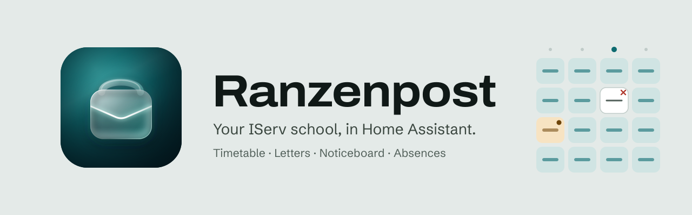
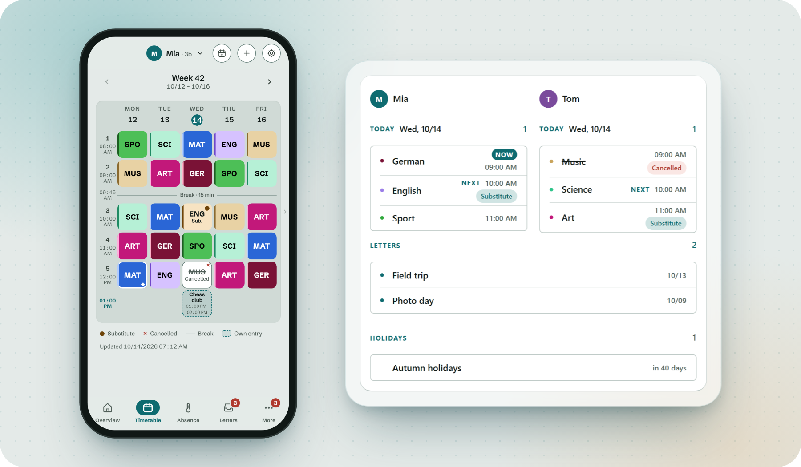
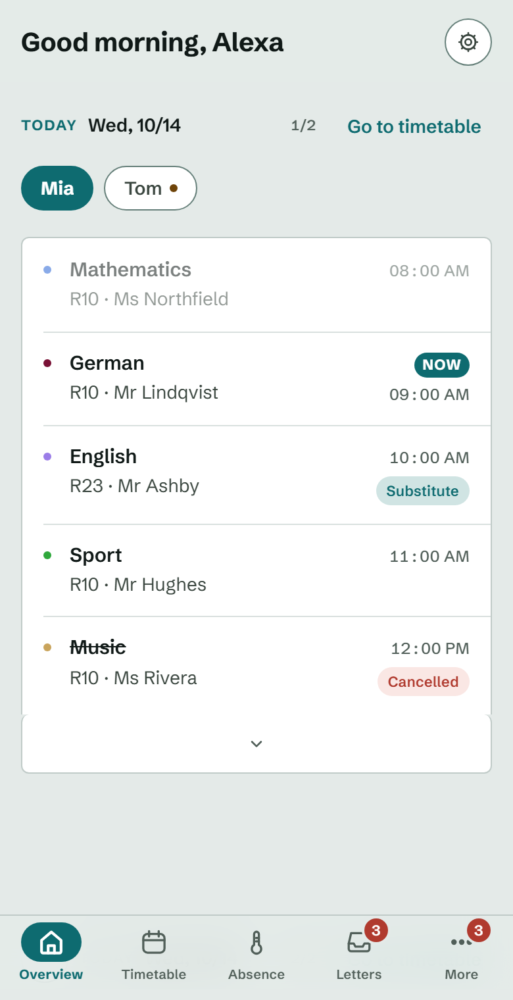
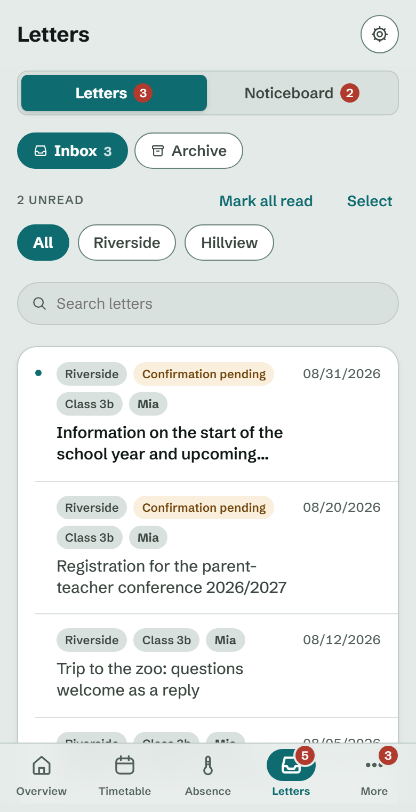
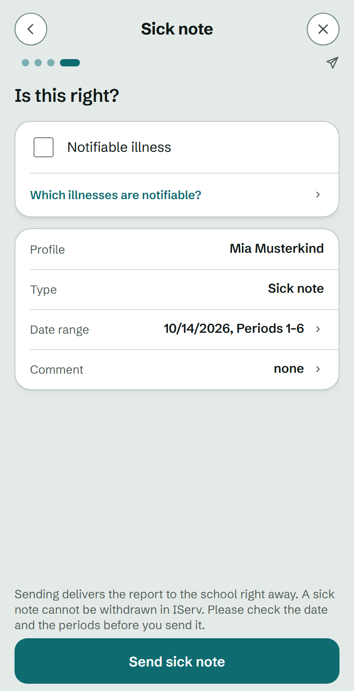
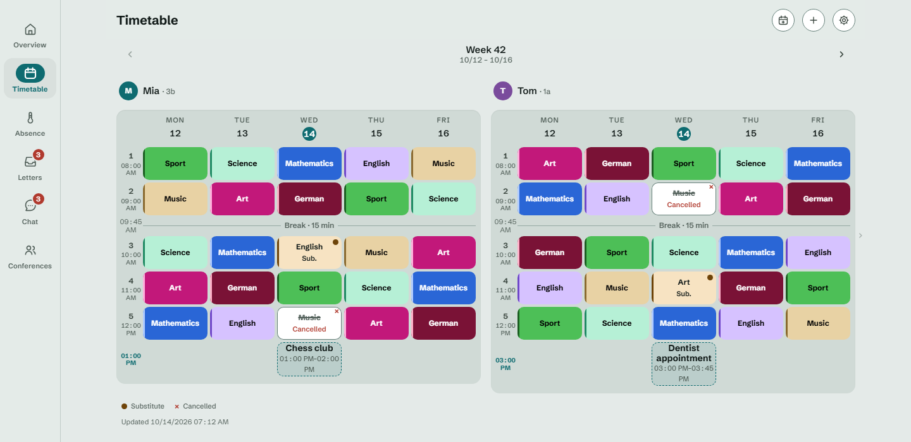

[English](README.md) | [Deutsch](README.de.md)

<p align="center">
  <picture>
    <source media="(prefers-color-scheme: dark)" srcset="assets/banner-dark.svg">
    
  </picture>
</p>

<p align="center"><b>Your children's school day in Home Assistant.</b><br>Timetable, substitutions, parent letters, the noticeboard, chat, school events, sick notes, tasks, news, email and files from your school's <a href="https://iserv.de">IServ</a>, as an app in the sidebar, a dashboard card and entities for your automations.</p>

<p align="center">
  <a href="https://github.com/githuber110/ranzenpost/actions/workflows/build.yml"></a>
  <a href="https://github.com/githuber110/ranzenpost/releases"></a>
  <a href="https://www.home-assistant.io"></a>
  <a href="https://hacs.xyz"></a>
  <a href="LICENSE"></a>
</p>

<p align="center">
  <picture>
    <source media="(prefers-color-scheme: dark)" srcset="docs/screenshots/hero-dark.png">
    
  </picture>
</p>

<p align="center"><sub>Every screenshot comes from the test fixture server. Children, teachers, schools and letters are invented.</sub></p>

<table>
  <tr>
    <td width="33%" valign="top"><b>The app in your sidebar</b><br>Timetable with substitutions, parent letters, noticeboard, chat, school events, tasks, news, email, files and sick notes. A sick note gets a review step before anything is sent.</td>
    <td width="33%" valign="top"><b>A card for every dashboard</b><br>Today, the next school day, the next lesson, the week, letters, holidays and more. Pick the blocks, the size and the children in the visual editor.</td>
    <td width="33%" valign="top"><b>Several schools, one app</b><br>Two children at two schools, or two accounts. One feed, one overview, each school on its own login.</td>
  </tr>
  <tr>
    <td valign="top"><b>Lessons in your phone's calendar</b><br>One feed per child for your calendar app: lessons, holidays, exams and absences. Link or QR code.</td>
    <td valign="top"><b>Devices, sensors and automations</b><br>Every child is a device with calendars, sensors and an event. Triggers such as "lesson cancelled" and conditions such as "is a school day" sit in the automation editor, without YAML.</td>
    <td valign="top"><b>Stays at home</b><br>Runs on your Home Assistant. No cloud, no account, no server in between. Logins are encrypted at rest.</td>
  </tr>
</table>

> [!NOTE]
> Ranzenpost is a hobby project by one parent and not affiliated with IServ GmbH. It started with one parent account at one school and reads the IServ modules listed further down. If your school runs a module that is missing, the settings page opens a prefilled issue for it.

## Install

You want both parts. The Ranzenpost app (formerly called add-on) signs in to IServ and shows Ranzenpost in the sidebar. The integration turns the same data into entities and the dashboard card.

### 1. Add the repository

[](https://my.home-assistant.io/redirect/supervisor_add_addon_repository/?repository_url=https%3A%2F%2Fgithub.com%2Fgithuber110%2Franzenpost)

Home Assistant opens and asks you to confirm the repository.

### 2. Install the app and run the setup

**Ranzenpost (IServ)** now appears in the App store. Open it, click **Install**, then **Start**. Open **Ranzenpost** from the sidebar. The setup asks for your school's address, your parent login and, if your school uses it, one code from the authenticator app you already have. Your authenticator keeps working. Then pick your children. Done.

If your school requires two-factor sign-in and the account has none yet, the setup sets it up with you: QR code, key and code. If your school switches it on later, Ranzenpost says so and walks you through it.

### 3. Add the integration

[](https://my.home-assistant.io/redirect/hacs_repository/?owner=githuber110&repository=ranzenpost&category=integration)

Install **Ranzenpost** in HACS and restart Home Assistant. Then go to **Settings, Devices & services, Add integration** and search for **Ranzenpost**. The running app is found on its own. If you start with the integration instead, it offers to install the app for you.

### Requirements

- Home Assistant 2025.6 or newer, as Home Assistant OS or Supervised. The App store needs the Supervisor.
- A machine with `amd64` or `aarch64`, for example a Raspberry Pi 4 or 5, a Home Assistant Green or Yellow, or an x86 box.
- An IServ parent account at a school that has switched on the parent modules.
- Two-factor login is what Ranzenpost was built and tested with. A login without two-factor works too and has been confirmed at a real school.
- HACS for the integration.

<details>
<summary>Install by hand, update, and Home Assistant without a Supervisor</summary>

**App by hand:** **Settings, Apps**, the **App store** (the **Install app** button at the bottom right), the menu in the top right, **Repositories**, paste `https://github.com/githuber110/ranzenpost`.

**Integration by hand:** open **HACS**, search for **Ranzenpost**, then **Download**. Ranzenpost is part of the HACS default store, so you no longer add it as a custom repository. If you added it that way before, nothing changes for you.

**Without a Supervisor:** the integration asks for the app's host, port and token. The token is in the app under **Settings, Home Assistant**, with a copy button.

**Updating:** keep both parts on the same release. A new setup updates the app on its own, and the integration options have a switch for it. If one part is behind, Home Assistant shows a repair notice with a button that installs the update, followed by a restart notice where needed. The app shows the same hint with a button. By hand: the app under **Settings, Apps**, **App store**, menu in the top right, **Check for updates**, then **Ranzenpost (IServ)** and **Update**; the integration in HACS under **Ranzenpost**, then restart Home Assistant. Settings and the school connection survive an update.

The documentation shown inside Home Assistant is [`iserv_connector/DOCS.md`](iserv_connector/DOCS.md).

</details>

## The app

### Overview

The overview collects what matters today in blocks you choose and order: today's lessons, the next school day, the next lesson, the week, changes, letters, posts, absences, chat, parent-teacher days, holidays, the school's events, tasks, news, forums, texts, info screens and whiteboards.

School events also get their own view: the shared calendars the account sees in IServ, for the next weeks.

<p align="center">
  <picture>
    <source media="(prefers-color-scheme: dark)" srcset="docs/screenshots/overview-today-dark.png">
    
  </picture>
  <picture>
    <source media="(prefers-color-scheme: dark)" srcset="docs/screenshots/two-schools-post-dark.png">
    
  </picture>
  <picture>
    <source media="(prefers-color-scheme: dark)" srcset="docs/screenshots/absence-wizard-review-dark.png">
    
  </picture>
</p>

<p align="center"><b>Today</b> opens on the current day and marks the running lesson. <b>Letters</b> merges the letters of both schools. <b>A sick note</b> is a few taps, and the last step restates everything before anything is sent.</p>

### Timetable

The week per child, with substitutions and cancellations marked, never dropped. Tap a lesson to mark an exam. Each school has a lesson times page: every period gets a start and a duration, from IServ or set by hand. Your own breaks, clubs and appointments repeat daily, weekly or every few weeks up to the summer holidays, for one child or all. Lessons come first: an entry that a lesson covers is shortened, never deleted. Subjects get one of 24 colours or your own, in light and dark. A class timetable with parallel courses shows one cell for the group; pick once which courses each child attends, and only those show up.

### Absences

All four IServ types: sick note, leave request, deregistration from bus, lunch or kindergarten, and day-care deregistration. Your school's rules are honoured: the cut-off time for a same-day sick note, the minimum notice for a leave request, the mandatory fields, and whether single lessons can be reported. Leave requests can carry attachments. A sick note can be saved or printed as a PDF, and the school's phone numbers are one tap away.

Schools that still use IServ's older absence page work too. Report an absence with attachments, read the change log, export the list and withdraw an entry, all in the app.

### Letters, noticeboard and chat

Parent letters, current and archived, with attachments. When a letter asks for a read confirmation, the app sends it the way the IServ website would, with an optional message to the school if the letter has a field for one. A letter that asks for a choice is answered in the app, and a sent answer can be changed. Noticeboards merge into one feed with full-text search. Chat runs through the IServ messenger where the school opens it to parents.

### Parent-teacher days

Current and archived days, your own bookings, teachers, rooms, free slots and notes, as IServ shows them. Booking, changing and cancelling a slot go through the school's own forms in the app, each after a confirmation. Ranzenpost then reads the page again and shows the result. Push messages tell you when booking opens, when a booking is cancelled, three days before a day and shortly before an appointment.

### Tasks and news

Open tasks come first by due date. Done and past tasks follow. A task opens with what its IServ page shows: text, dates, tags, files, the own hand-in, feedback and model solutions. Ranzenpost reads that page only when you open the task, never in the background. You hand in files and text, remove handed-in files and mark a task as done in the app, each after a confirmation. Ranzenpost then reads the task page again and shows the result.

Every news item is listed with its category and date. News can be filtered by category and searched. The archive and the package news show when you pick them in the filter, and Ranzenpost reads them only then. A news item opens in the app with its full text, files and links. Files open and download through Ranzenpost.

### Forums, texts, info screens and whiteboards

Forums lists every forum the account sees, with its section and its unread posts. Mark all read asks first. Texts lists every text the account sees, hidden ones too, with owner, dates and tags. It has a filter by selection and by tag, and a search. Info screens lists the info screens the account sees by name. Whiteboards lists the whiteboards the account sees with owner and dates. These four areas appear only where the account has the module.

### Email

The IServ mailbox lives in its own area: folders, search with filters, reading, replying, forwarding, drafts and attachments. Flags, tags, moving, archiving and read receipts work as in IServ. Recipients and groups come from the school's address search, and you pick the sender address. An email can become an event in your IServ calendar. Out-of-office note, forwarding, filter rules and signatures are edited in the app through IServ's own settings forms. Sending, deleting for good and every settings change ask first. Mark as spam moves an email to the spam folder of the mail server after a confirmation, and Undo moves it back. Not spam moves an email from the spam folder to the inbox. Recipients also come from the address book and from a mailing list you pick.

### Files and contacts

Accounts with files see their own files and their group folders, open folders, search and download a file through the app. An upload into your own files or a group folder asks first and shows the list again afterwards. The contacts area searches the school's address book and writes an email to a person. Mailing lists show their addresses. A list is imported from a text or CSV file or deleted, each after a confirmation.

### Several schools

Each school or account keeps its own login, children, names and lesson times. Letters and posts merge into one feed with a school chip on every row and a filter per school. Children are ordered by first name across schools. A school whose login fails is flagged on its own while the others keep working. A school that lists no children for your account still brings its letters, posts and chat. Where no child decides the school, for example in teacher search, the app asks which school you mean.

### The lessons in your phone's calendar

A feed per child that your calendar app subscribes to: lessons, school holidays, public holidays, marked exams, approved absences, your own entries and the school's events, each switchable. An account without a linked profile gets a feed per school with holidays and school events. Link or QR code. The link can be renewed or deleted at any time.

The feed is served on a second port, 8100, which is **off by default**. Switch it on under **Settings, Apps, Ranzenpost (IServ), Configuration, Network**. Whoever has the link sees that child's timetable, so treat the link as the secret. Nabu Casa remote access does not forward app ports, so outside your home network the feed needs your own remote access or a VPN.

When you create a calendar you choose where you use it. **Only at home (Wi-Fi)** works on your home network or over VPN and never leaves it. **Everywhere** also works away from home and in Google Calendar and Outlook.com: the Ranzenpost integration serves the feed as a Home Assistant webhook, through Home Assistant Cloud (Nabu Casa) or your own external URL. Without either, only home use is offered. Renewing or deleting the link ends the old address at once.

### Languages and themes

German, English, Arabic, Turkish, Russian and Ukrainian. Arabic runs right to left. Dates, times and numbers follow the language. Light and dark theme, following the device or pinned. Large system font sizes are respected.

### Tablet and laptop

From 900 pixels wide, a navigation rail replaces the tab bar. From 1280 pixels, letters, posts, absences, chats and settings open in a pane beside their list, and the timetable shows every child side by side.

<p align="center"></p>

## Home Assistant

### Dashboard card

The integration registers `custom:ranzenpost-card`. Add it from the card picker and set it up in the visual editor: a title, the children, the blocks and a size per block. The card follows the dashboard's language and theme. It is built from the same blocks as the app's overview: `today`, `next_day`, `next_lesson`, `week`, `changes`, `letters`, `noticeboard`, `absences`, `conferences`, `holidays`, `school_events`, `tasks`, `news`, `forums` and `texts`. Only blocks of modules your school has are offered. A block without content is not drawn, and most blocks open the app with "Show all"; the holidays block has no such link. With several children the day blocks sit side by side and the family blocks come once. An account without a linked profile still gets letters, noticeboard, conferences, holidays, school events, tasks, news, forums and texts of its school.

```yaml
type: custom:ranzenpost-card
title: School
blocks:
  - key: today
    size: compact
  - letters
  - holidays
children:
  - mia
  - tom
```

<details>
<summary>More card examples</summary>

A wall tablet in the hallway, one child, the week at a glance:

```yaml
type: custom:ranzenpost-card
blocks:
  - next_lesson
  - key: week
    size: compact
children:
  - mia
```

For packing the schoolbag in the afternoon, the today block shows the next school day from 15:00:

```yaml
type: custom:ranzenpost-card
blocks:
  - key: today
    switch: "15:00"
children:
  - mia
```

Without day blocks, for a phone dashboard:

```yaml
type: custom:ranzenpost-card
blocks:
  - changes
  - letters
  - absences
  - conferences
```

`children` takes first names, first names with the school in brackets, or the children's keys from the app. Leave it out for every child. Each block is a key or a key with a `size`, `compact` or `normal`. The `today` block also takes `switch`: `end` shows the next school day after the last lesson, a time such as `"15:00"` from that time on. The `next_day` block always shows the next school day, labelled tomorrow or with its weekday and date. The older `view` and `child` keys still work.

</details>

### Devices, entities and automations

The integration creates one device per school and one per child. Entity IDs use the first name, for example `sensor.ranzenpost_mia_next_lesson`. Entities exist only for the modules your school has.

- **Per child:** calendars for lessons, exams, absences and own entries. Sensors for the current and next lesson, the end of school, the next school day, changes today, the next exam, unread letters and posts, and open absences. Two binary sensors, `school_day_today` and `timetable_changed_today`. One event that fires on a substitution, cancellation or room change.
- **Per school:** calendars for holidays and school events. Sensors for the next holiday, the next free day, the next parent-teacher conference, unread letters, posts and emails, open tasks, news, unread forum posts, texts and the connection.

In the automation editor, pick a child's device for triggers such as **Timetable changed**, **Lesson cancelled** or **New letter**, and for conditions such as **Is a school day**. No YAML needed. The integration asks the app every 60 seconds and never talks to IServ itself.

The [Home Assistant reference](docs/home-assistant.md) lists every entity with its attributes, all triggers and conditions, and four automation recipes to copy.

### Push messages and repairs

The app sends a message to the notify services you pick, for example the Home Assistant app on your phone. Messages cover timetable changes, new letters, new posts, new conference days, new chat messages, new tasks, new news items, new forum posts and new texts. Every kind except the sign-in alert can be switched off in the settings. Each target has a test button, and the texts come in all six languages. When a school's login needs you, Home Assistant shows a repair that names the school and says what to do. It clears on its own once the login works.

## Supported IServ modules

IServ ships some modules in an old and a new edition. Ranzenpost reads the editions listed here. The settings page lists the modules your account offers and hides the areas of the ones it does not. The name in brackets is the module's address behind `/iserv/` on your school's server; open it there to check whether your school has the module.

| Module | IServ edition Ranzenpost reads | Reads | Writes |
| --- | --- | --- | --- |
| Timetable (`dsa-timetable`, `time-table`) | The Schul-App timetable. If it lists no lessons, the older `time-table` module | Lessons, substitutions, cancellations, lesson times | Nothing. Exam marks stay in the app |
| Absences (`dieschulapp`, `absence`) | Absences (Schul-App), or the older absences page | Reported absences and their status, the school's rules; on the older page also the change log | Sick note, leave request with attachments, deregistration, day-care deregistration; on the older page a report with attachments and withdrawing it |
| Parent letters (`parentletter`) | Parent letters | Current and archived letters, attachments | Archive, read confirmation with optional message, a message to the school on a letter that offers a reply, the answer to a letter that asks for a choice |
| Noticeboards (`dieschulapp`) | Pinboards (Schul-App) | All boards, posts, attachments | Nothing. Read state stays in the app |
| Chat (`messenger`) | Messenger, where the school opens it to parents | Rooms and messages | Send a message, mark as read, open a room with a teacher |
| Parent-teacher conferences (`parentconference`) | Parent conferences | Current and archived conference days, own bookings, teachers, rooms, free slots and notes as IServ shows them | Booking, changing and cancelling a slot through the school's own forms, each after a confirmation |
| School events (`calendar`) | Calendar, where the account sees it | Events of every calendar the account sees, its personal calendar included, for the next weeks | An event made from an email, after a confirmation |
| Tasks (`exercise`) | Tasks | Current and past tasks as IServ lists them; the page of a task when you open it: text, dates, tags, files, own hand-in, feedback, model solutions | Hand in files and text, remove handed-in files, mark as done or not done, each after a confirmation |
| News (`news`) | News | Every news item of the list with title, date and category, and the text, files and links of each item; the archive and the package news when you pick them in the filter | Nothing. Filter and search work in the app |
| Forums (`forums`, `forum`) | Forums | Every forum of the overview with its section, description, unread posts and last post | Mark everything as read, after a confirmation |
| Texts (`etherpad`) | Texts | Every text the account sees in each IServ selection, also hidden ones, with owner, dates and tags | Nothing. Filter and search work in the app |
| Info screens (`infodisplay`) | Info display | The info screens the account sees, by name | Nothing |
| Whiteboards (`excalidraw`) | Whiteboards | The whiteboards the account sees, with owner and dates | Nothing |
| Email (`mail`) | IServ mailbox | Folders, emails with attachments, search, tags, sender addresses, recipient and group search, the mail settings | Send, reply, forward, drafts, flags, tags, move, archive, delete, folders, read receipts, out-of-office note, forwarding, filter rules, signatures, mark as spam and not spam, with undo |
| Files (`file`) | Files | Own files and group folders with name, size, type and date, the search, the files themselves | Upload into the own files and group folders, after a confirmation |
| Address book (`addressbook`) | Address book | People found by a search, with address and class, also as email recipients | Nothing |
| Mailing lists (`mailinglist`) | Mailing lists | Lists and their addresses | Import from a text or CSV file, delete, each after a confirmation |

Klassengeld is recognised but not supported yet. It runs as a separate service behind an IServ consent step, and it is open for a contributor whose school uses Klassengeld and who would like to build the support. See [issue #5](https://github.com/githuber110/ranzenpost/issues/5).

A school that only offers the older timetable module, at `/iserv/timetable/`, shows it in the settings as present, not supported yet, instead of showing the timetable as missing. Modules Ranzenpost does not know yet appear in the settings by their IServ name, with a button that opens a prefilled issue.

## Privacy

- Everything runs on your Home Assistant. There is no account with us and no server of ours.
- Three outbound destinations: your school's IServ server, `openholidaysapi.org` for holiday dates, and `openplzapi.org` once to turn the school's postal code into a federal state. Those two requests carry a federal state and a year, or a postal code, nothing else.
- Your school address, login and the app's own two-factor key stay in the app's `/data` folder. Login and two-factor key are encrypted at rest. With a **passphrase** in the app options the key is derived from it at start and never written to disk.
- Only children your account lists are read. The app never tries other IDs.
- Ranzenpost writes to IServ only when you act. Sending, booking, answering, handing in, uploading, importing, changing settings and deleting for good ask first. Nothing is sent on your behalf.
- **Disconnect** removes the app's two-factor token from IServ, then deletes the school's data locally. If IServ cannot be reached, the school stays until you try again or disconnect anyway.
- The repository contains no personal data. All test data is invented.

## Getting help

1. In the app, open **Settings, Help, Report a problem** and tap **Save report**. It bundles versions, the structure of each IServ module and the app log into `ranzenpost-report.zip`. Names, amounts, addresses and secrets are removed. For modules run by another provider, such as Klassengeld, the report signs in there once. It opens no letter and no single entry. Nothing is sent on its own.
2. Open an [issue](https://github.com/githuber110/ranzenpost/issues) and attach that file. German is welcome.
3. For a security problem, do not open a public issue. See [SECURITY.md](SECURITY.md).

The [changelog](iserv_connector/CHANGELOG.md) lists what changed in each release.

## Contributing

Bug reports, translations and pull requests are welcome. [CONTRIBUTING.md](CONTRIBUTING.md) has the development setup, the test suites and the code conventions. The release notes credit everyone who contributes.

## License

MIT, see [LICENSE](LICENSE). The bundled fonts are licensed under the SIL Open Font License 1.1.

<details>
<summary>Fonts</summary>

- **Archivo**, The Archivo Project Authors, [github.com/Omnibus-Type/Archivo](https://github.com/Omnibus-Type/Archivo)
- **Schibsted Grotesk**, Schibsted Media, [github.com/schibsted/schibsted-grotesk](https://github.com/schibsted/schibsted-grotesk)
- **Inter**, The Inter Project Authors, [github.com/rsms/inter](https://github.com/rsms/inter)
- **Noto Sans Arabic**, The Noto Project Authors, [github.com/notofonts/arabic](https://github.com/notofonts/arabic)

The licence texts are in [`frontend/fonts/`](frontend/fonts/).

</details>

## Support the project

Ranzenpost is built in the evenings by one parent and stays free. If it saves you a few trips to the IServ website:

<a href="https://buymeacoffee.com/githuber110"></a>
